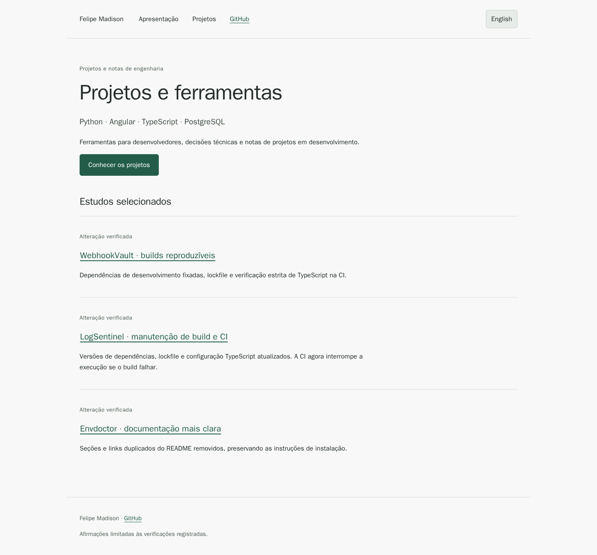

# Portfolio



A bilingual Angular catalogue of verified engineering changes.

[Português](README.pt-BR.md) · [Public site](https://felipemadson.github.io/portfolio/)

## Run locally

```sh
npm --prefix frontend ci --ignore-scripts
npm --prefix frontend start
```

## Build and test

```sh
npm --prefix frontend test
npm --prefix frontend run build
```

GitHub Pages hosts the static build in docs/. Linked applications and databases run separately. Case evidence is stored under docs/evidence. Changes require a new immutable package; the private pipeline and credentials are not part of this repository.

## Scope

## [WebhookVault · reproducible builds](https://github.com/FelipeMadson/webhookvault)

Pinned development dependencies, added a lockfile and configured strict TypeScript checks in CI.

This update improves tooling and CI processes but does not certify the entire webhook product or its legacy public claims. Maintenance of dependencies and CI is handled by the linked repository, and this portfolio is static.

[Verified revision](https://github.com/FelipeMadson/webhookvault/commit/63e1c58c2ba7443aae913505572600cbb573cdc3)

## [LogSentinel · build and CI maintenance](https://github.com/FelipeMadson/logsentinel-memory-guard)

Updated dependency versions, the lockfile and TypeScript configuration. CI now stops when the build fails.

Installation, build, strict type checking and the existing tests were verified for this change. They do not certify every product feature or legacy badge.

[Verified revision](https://github.com/FelipeMadson/logsentinel-memory-guard/commit/6e412187862151739cc89bfa228baed884dacd35)

## [Envdoctor · clearer documentation](https://github.com/FelipeMadson/envdoctor)

Removed duplicated README sections and links while preserving installation instructions.

This change covers documentation. It does not certify the full product or the security and mutation-testing claims in legacy badges.

[Verified revision](https://github.com/FelipeMadson/envdoctor/commit/729ade740c7b21bf88e15f5473eec7d8126e8822)
